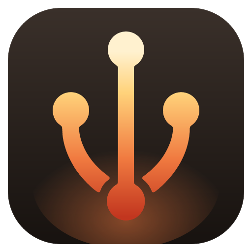

# Stoke

Stoke is a local PHP development environment for Windows and macOS: PHP versions, `.test` sites with HTTPS, databases and other services, a mail catcher, dumps and logs, all managed from one tray app, a `stoke` command line and an MCP server for AI coding tools.

Work in progress. Licensed under the MIT license.
